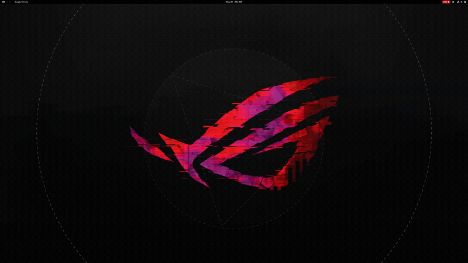
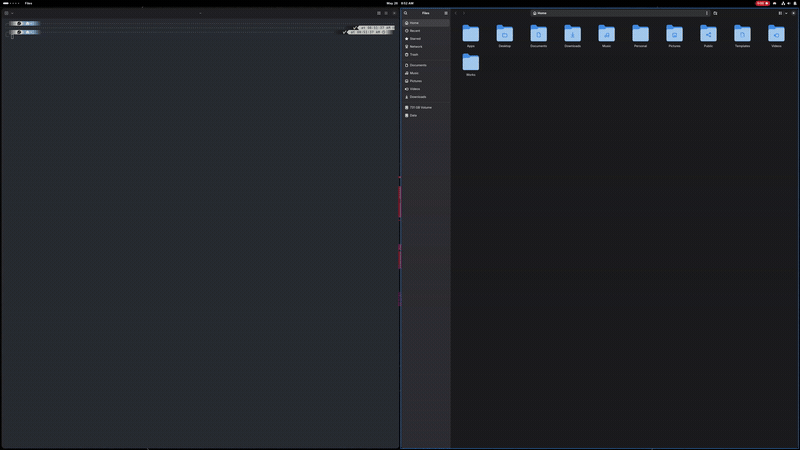

# Dwindle for GNOME

> [!IMPORTANT]
> This is Taylor Beeston's personal GNOME configuration, published only as source history and backup. It is tailored to one workstation, including hard-coded `eDP-1` and `Meta-0` behavior. It is not intended as a general-purpose extension, supported product, or upstream alternative; other people should expect to adapt and maintain it themselves.

The extension combines a Hyprland-style dwindle layout with Taylor's monitor-local workspaces, shortcuts, panel layout, and WayVR integration.

## Demo

**Dwindle (BSP) auto-tiling** — open several terminals (`Super+Enter`) and each new window automatically splits the largest space. The colored outline marks the focused window.



**Moving windows around** — rearrange the layout by swapping the focused window with its neighbors (`Super+Shift+Arrow`).



## Features

- **Dwindle (BSP) auto-tiling** — new windows split the largest available space; split direction alternates with aspect ratio. One BSP tree per monitor per workspace.
- **Configurable workspace count** (1–9), persisted as `num-workspaces`; native `Super+N` bindings auto-managed.
- **i3-style keybindings** — workspaces, directional focus, window swap, resize, move-to-monitor, and quick actions. All rebindable from the prefs UI.
- **Window swap** — `Super+Shift+Arrow` swaps the focused window with its BSP neighbor in that direction (works across nested splits).
- **Resize** — `Super+Ctrl+Arrow` moves the split border; step size configurable in px.
- **Multi-monitor** — `Super+Shift+Ctrl+Arrow` moves the focused window to the monitor in that direction and re-tiles it there.
- **Monocle / zoom** — `Super+F` shows only the focused window at full work-area size (others are minimized) and puts a `Monoculo` pill in the panel so you know you're in that mode; press again (or click the pill) to restore the layout.
- **Built-in terminal launcher** — `Super+Enter` runs a configurable command (default `ghostty`).
- **Floating windows** — per-window toggle (`Super+V`) and per-app defaults via a WM_CLASS list (checkbox UI + manual entries in prefs).
- **Focus border** — colored outline around the active window (color / width / on-off configurable); sits in the gap, hidden in the overview and below shell modals.
- **Strict mode** — tiled windows snap back to their calculated geometry when dragged or resized.
- **Native GNOME overrides** — disables `edge-tiling`, `auto-maximize`, the `Super+Arrow` snap bindings, the native move-to-workspace/monitor bindings, and the `Super+F1` system-help binding while enabled; everything is restored on disable.
- **Top-panel layout control** — reposition *any* panel indicator (left / center / right / hidden), reorder within each side, and adjust spacing between indicators — all from the prefs UI, no custom indicators required.
- **Focused-app indicator** — optional panel item showing the name of the currently focused app; positionable and orderable like any other indicator.
- **Secondary workspace bar** — `Meta-0` gets its own top bar with clickable local workspace buttons and an active-workspace highlight. It also mirrors the AppIndicator tray icons from the main bar, and clicking a mirrored icon opens that app's menu on `Meta-0`.
- **Slurp-style screenshots** — `Print` immediately selects a region and opens it in Swappy, without GNOME's full screenshot UI.
- **Help overlay** — `Super+F1` (or `Super+/`) opens a searchable, GNOME-styled cheat sheet listing every action with its *current* shortcut (reflects rebindings live).
- **Live prefs UI** (libadwaita) — organized into tabs: General, Barra (panel), Terminal, Flotantes (floating apps), and Atajos (keybinding editor).
- **Discovery** — `Super+I` shows the WM_CLASS of the focused window so you can configure new floating apps without guessing.

## Keybindings

Defaults below. Every binding can be reassigned in **Prefs → Atajos** (click a row, press the new combo; Esc cancels, Backspace/Delete clears).

| Shortcut | Action |
|---|---|
| `Super+1..N` | Switch to workspace N (native GNOME) |
| `Super+Shift+1..N` | Move active window to workspace N without switching workspaces |
| `Super+Left/Right/Up/Down` | Focus the window in that direction |
| `Super+Shift+Left/Right/Up/Down` | Swap the focused window with its neighbor |
| `Super+Shift+Ctrl+Left/Right/Up/Down` | Move the focused window to the monitor in that direction |
| `Super+Ctrl+Left/Right/Up/Down` | Resize (move the split border; step in px) |
| `Super+Enter` | Open terminal (configurable command) |
| `Super+F` | Monocle: show only the focused window full-size (others minimized) |
| `Super+T` | Toggle auto-tiling |
| `Super+V` | Toggle active window: tiled ↔ floating |
| `Super+Q` | Close focused window |
| `Super+B` | Toggle decoration (SSD only — see Limitations) |
| `Super+I` | Show WM_CLASS of focused window (notification + log) |
| `Super+F1` / `Super+/` | Show/hide the help overlay |
| `Print` | Drag-select a region and open it in Swappy |

All bindings are stored under `org.gnome.shell.extensions.dwindle`. The prefs editor writes the same keys, and changes apply live (no re-enable needed) because the bindings watch their GSettings keys.

## Install

```bash
git clone <repo> ~/Personal/tiling-extension
cd ~/Personal/tiling-extension
make install
# Log out and back in once so GNOME loads the reloadable entry point
make enable
```

`make install` symlinks this directory into `~/.local/share/gnome-shell/extensions/dwindle@taylorbeeston`. The first install, and edits to the stable `extension.js` loader itself, require logout/login. Normal development in `runtime.js` and its helper modules uses `make reload` without ending the Wayland session.

## Configure

Open `Extensions` → `Dwindle` → gear. The prefs window is split into tabs:

- **General** — workspace count (1–9), auto-tiling, strict mode, disable-native toggle, gap size, resize step (px), and the focus border (enabled / width / hex color).
- **Barra** — spacing between panel indicators, the "show focused app" indicator toggle, a clickable local-workspace bar on `Meta-0`, a toggle for the tray icons on that bar, and a per-indicator list to set position (default / left / center / right / hidden) and reorder within each side.
- **Terminal** — the command run by `Super+Enter`, plus a list of detected terminals you can pick from.
- **Flotantes** — search-filtered checkbox list of installed apps that should open floating, plus manual WM_CLASS entries.
- **Atajos** — GNOME-style keybinding editor: action on the left, current shortcut on the right, pencil/row click to rebind.

Anything not surfaced in the UI can still be edited with `dconf-editor` under `/org/gnome/shell/extensions/dwindle/`.

## Limitations

- **The stable loader needs one initial logout/login**. After GNOME loads it, `make reload` recompiles schemas, disables the current runtime cleanly, and imports fresh cache-busted copies of `runtime.js` and its helper modules without ending the Wayland session. Editing the loader in `extension.js` itself still requires logout/login. `prefs.js` is re-read whenever preferences opens.
- **Strict mode is snap-back, not lock**. The extension is a compositor extension, not the WM, so it can't prevent a drag — only reapply geometry on `grab-op-end`. For true locking use Hyprland or Sway.
- **`Super+B` decoration toggle does nothing for CSD apps**. GTK / libadwaita apps draw their own titlebar inside the window content; only the app can hide it. The toggle works for SSD apps (xterm and similar); the extension shows a notification when it can't.
- **`StartupWMClass` in `.desktop` files is sometimes wrong**. Some apps report a different runtime WM_CLASS than the desktop file declares (e.g. Proton VPN — desktop says `protonvpn-app`, runtime says `proton.vpn.app.gtk`). Use `Super+I` to find the real value, then add it via Prefs → Flotantes → Entradas manuales.
- **Directional focus (`Super+Arrow`) stays on the current monitor**. To cross monitors, move the window with `Super+Shift+Ctrl+Arrow`.

## Develop

```bash
make build      # recompile schemas after editing the XML
make reinstall  # remove old symlink and re-link
make reload     # hot-reload runtime/helper/schema changes without logout
make pack       # build a zip suitable for extensions.gnome.org
make status     # show extension info / enabled state
make clean      # remove build artifacts
```

After the initial `make install` and one logout/login, use `make reload` for edits to `runtime.js`, `animationMath.js`, `workspaceMath.js`, `secondaryWorkspacePanel.js`, and `schemas/*.xml`. GNOME keeps `extension.js` cached, so changes to that small stable loader still need logout/login. `prefs.js` is picked up each time the preferences window opens.

## License

MIT. See [LICENSE](./LICENSE).

## Credits

Original author: George Dakhil. Fork maintained by Taylor Beeston.
